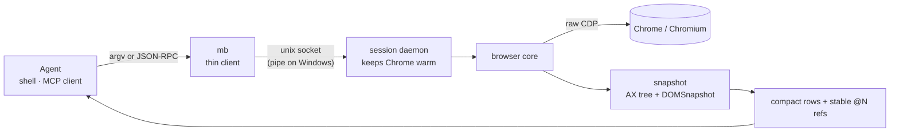
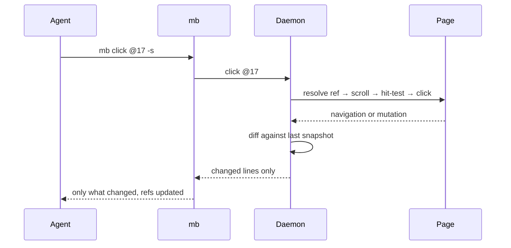

<div align="center">


**Headless, turnkey browser CLI for AI agents.**
Raw Chrome DevTools Protocol — no Playwright — a warm daemon, and compact accessibility
snapshots with stable `@N` refs.

[](#status--roadmap)
[](https://nodejs.org)
[](LICENSE)
[](#how-it-works)
[](#mcp-server)

[Quick start](#quick-start) · [Why](#why-monad-browser) · [Benchmarks](#benchmarks) · [How it works](#how-it-works) ·
[Commands](#command-reference) · [MCP](#mcp-server) · [Agent skill](#agent-skill) · [Screenshots](#screenshots)

</div>

---

`mb` drives a real headless Chrome from the shell. One command opens a page and returns a compact
accessibility snapshot in which every interactive element has a short, stable reference. The agent
reads the refs, acts on them, and gets back only what changed.

```sh
mb open news.ycombinator.com
mb snapshot -i          # interactive elements only, each with an @ref
mb click @17 -s         # click, then print a fresh (diff) snapshot
mb fill @3 "hello"
mb press Enter
mb read https://example.com/article   # markdown/text without launching Chrome
mb find role button click --name Submit
mb get value @3
mb eval 'return [...document.links].length'
mb screenshot page.png --annotate
mb stop
```

The first command launches Chrome and a per-session daemon; every command after that is a single
local-socket round trip (a unix socket, or a named pipe on Windows), so a warm `mb` call costs
roughly 40 ms.

## Quick start

```sh
npm i -g monad-browser
mb open example.com
```

Or work from source:

```sh
git clone https://github.com/batuhanozkose/monad-browser
cd monad-browser
npm install            # installs the two build-time dev dependencies
npm run build          # tsc -> dist/
npm link               # put `mb` on your PATH
```

> Chrome or Chromium must be installed. `mb` finds the usual locations; point it elsewhere with
> `MONAD_CHROME=/path/to/chrome` (a bare command name such as `chrome` also works).
> `npm run build:native` is optional — it compiles the Go thin client for a faster hot path.
>
> On Windows, `mb` runs on Node (the Go thin client is built for Linux/macOS); Chrome, Edge or
> Chromium is found automatically. Installs with `--ignore-scripts` work the same way, so npm 12's
> default script policy does not break the launcher.

A real session — open Hacker News, list the interactive elements, follow one story:

<p align="center"></p>

Three concepts are doing the work here:

- **`-i`** keeps only interactive nodes, so a news front page is a handful of lines, not a wall.
- **`@N` refs** are assigned by the snapshot and stay stable for the lifetime of the element. After a
  re-render they self-heal by role + accessible name, so a stale `@17` still lands on the same story.
- **`-s`** on an action returns the page *diff* instead of the whole page — the exact lines that
  changed, under their parent, with the refs already updated. (On a navigation there is no baseline
  left to diff against, so you get a fresh full snapshot.)

## Why monad-browser

- **Fewer tokens, same content.** The snapshot merges the accessibility tree with `DOMSnapshot`
  layout and collapses rows, list items and paragraphs onto one line with inline refs. Across the
  benchmark's six pages that is **47k tokens vs 109k for agent-browser and 184k for Playwright /
  Chrome DevTools MCP** — at **95–100 % information retention** ([chart](#benchmarks)).
- **One turn, not twenty calls.** `mb run` executes a whole multi-step plan in a single call and
  returns only what you `log()` or `return`.
- **Read without a browser.** `mb read` fetches markdown, `llms.txt` docs indexes, or a compact
  readability pass over HTML — no Chrome, no snapshot. `mb get` and `mb is` answer one targeted
  question instead of returning the whole page.
- **Actions that wait.** Every action waits until the target is attached, visible, stable, enabled
  and not covered. If a cookie banner or modal is over it, the error names the cover instead of
  clicking the wrong thing.
- **A warm browser.** A daemon keeps Chrome alive between commands (default idle 30 min), and a
  native Go thin client skips Node start-up on the hot path.
- **No LLM in the loop.** `mb` is a deterministic tool; your agent decides, `mb` executes.
- **Both interfaces, one browser.** The CLI and the MCP server share the same warm session, so an
  agent can mix `browser_run` tool calls with shell `mb` commands on one tab.
- **Zero runtime dependencies.** Only the Node standard library, plus an optional native client
  compiled from the Go source in [`native/`](native/).

**Also included**

- Diff snapshots (`snapshot -d`, or `-s` on any action) with an exact Myers line diff, revisions,
  `--full` baseline reset, and an optional compact `--json` patch.
- Same-process **and out-of-process (cross-site) iframes** in the snapshot, with working refs,
  clicks and fills inside them.
- Sessions (`--session`), saved auth state (`state save/load`), tabs, console capture.
- Targeted queries (`get`, `is`, `find`), form helpers (`check`, `upload`, `download`, `pdf`,
  `drag`), and annotated or change-only screenshots.
- Cookies, localStorage/sessionStorage, request inspection, request routes/aborts, viewport and
  device emulation, media/offline/header/geo overrides.
- Optional **snapshot cache** (`mb snapshot --cache`, `--cache-ms N`, `MONAD_SNAPSHOT_CACHE_MS`):
  reuse the last snapshot while the page is unchanged, guarded by a MutationObserver version;
  off by default.
- Proxies with credentials via a local relay that injects `Proxy-Authorization`.
- Resource blocking (`--block image,font,media`) to make pages cheaper.
- Attach to an existing Chrome (`--cdp <ws|port>`) or run headful (`--headful`).

## Benchmarks

Measured 2026-10-09. Every tool drove the **same Chromium 154 binary** through the same proxy,
against the same pages, back to back. Tokens are counted with `o200k_base` on exactly the text an
agent would read; latencies are medians (n=3, clicks n=5). Full method, per-page numbers and the
harness live in **[BENCHMARK.md](BENCHMARK.md)** and [`bench/`](bench/).

<p align="center"></p>

<table>
<tr>
<td width="50%"></td>
<td width="50%"></td>
</tr>
</table>

| Page | monad CLI | monad MCP | agent-browser | Playwright CLI | Playwright MCP | Chrome DevTools MCP |
| --- | --- | --- | --- | --- | --- | --- |
| form | 98 | 97 | 177 | 300 | 299 | 291 |
| example | 232 | 231 | 267 | 340 | 339 | 320 |
| Hacker News | 2.4k | 2.4k | 7.0k | 14k | 14k | 13k |
| books | 2.5k | 2.5k | 5.4k | 8.7k | 8.7k | 8.3k |
| MDN `<select>` | 12k | 12k | 25k | 43k | 43k | 36k |
| Wikipedia | 31k | 30k | 72k | 118k | 118k | 143k |
| **Total** | **47k** | **47k** | **109k** | **184k** | **184k** | **202k** |

<p align="center"></p>

<p align="center"></p>

monad keeps the same content as agent-browser by default (Wikipedia 47 % → 95 %) at less than half
the tokens. Interactive-only snapshots fall to **17k** tokens (agent-browser `-i`: 43k), and the
whole MCP surface loads in **~1.3k schema tokens** versus 3.7k / 5.5k (and 12.7k for
agent-browser's core profile).

### Whole-task cost

Four tasks, driven by an agent: fill a form · open HN comments · paginate books.toscrape ·
search Wikipedia. `tokens` is everything the agent read; `calls` is how many tool calls it took.

| Tool | tasks passed | total tokens | total calls |
| --- | --- | --- | --- |
| monad CLI | 3 / 4 | **45k** | **12** |
| monad MCP | 4 / 4 | 76k | 12 |
| agent-browser | 3 / 4 | 28k | 24 |
| Chrome DevTools MCP | 4 / 4 | 321k | 22 |
| Playwright CLI | 4 / 4 | 363k | 23 |
| Playwright MCP | 4 / 4 | 365k | 23 |

<p align="center"></p>

**Where monad still loses** — stated honestly: click latency is 31 ms vs agent-browser's 24 ms
(monad waits one tick to catch navigations and returns a diff; agent-browser returns `✓ Done`
immediately); multi-navigation `run` scripts are slower than `agent-browser batch` (613 vs 437 ms);
and because actions return the new page, navigation-heavy tasks read more tokens but need half the
calls.

## How it works



A click is a single round trip and the reply is only what changed:



- **Thin client.** On Linux/macOS a small Go binary ([`native/`](native/)) forwards the command over
  a unix socket (a named pipe on Windows) — one round trip, no Node start-up (~6 ms vs ~55 ms).
  Everything else (starting the daemon, `mcp`, `install-skill`, help, Windows) falls back to Node.
- **Daemon.** Starts Chrome on first use, keeps one browser per session, exits after
  `MONAD_IDLE_MINUTES` (default 30) of inactivity.
- **Snapshot.** Accessibility tree merged with `DOMSnapshot` layout; hidden nodes are dropped;
  `cursor:pointer` elements without an ARIA role appear as `clickable`. Long rows collapse to one
  line with inline refs. Refs are stable and self-heal by role + name.
- **Readiness.** `DOMContentLoaded` then `load` (or 50 ms of quiet), capped at 1 s — not full
  network idle — plus a short pre-action hydration grace (`MONAD_PRE_ACTION_QUIET_MS`, default 500).
- **Actionability.** One in-page call checks attached + visible + stable + enabled + hit-test; the
  click itself is hit-tested so a covering element produces an error that names it.

## One-turn plans with `mb run`

For anything beyond a couple of steps, `run` sends the whole plan in one call. The script executes
in the daemon against the current tab; **only what you `log()` or `return` comes back**.

<p align="center"></p>

```sh
mb run '
  await goto("books.toscrape.com");
  const titles = [];
  for (let i = 0; i < 3; i++) {
    titles.push(...await js("[...document.querySelectorAll(\"h3 a\")].map(a => a.title)"));
    await click("text=next");
  }
  return titles.length;
'
```

Also `mb run --file plan.js` or pipe a script with `mb run -`.

**API inside `run`:**
`goto` `open` `click` `dblclick` `fill` `type` `press` `select` `hover` `scroll` `text` `js`
`snapshot` `exists` `wait(ms|target)` `waitForText` `waitForIdle` `screenshot` `back` `reload`
`cdp` `tabs` `url` `title` `log` `sleep` `readFile`.

> `run` scripts are **trusted, not sandboxed** — they execute in the daemon process (Node `vm`).
> It is a convenience wrapper, not a security boundary.

## Diff snapshots

Stable refs make the diff exact. `-s` on any action prints only the changed lines, under their
parent; `mb snapshot -d` does the same on demand.

The baseline is per tab **and option set**: a snapshot taken with `--max-text 20` is never diffed
against one taken with the default. `--full` returns a full snapshot and resets the baseline;
`--json` returns a compact machine-applicable form instead of text:

```jsonc
{"kind":"delta","baseRevision":3,"revision":4,"treeChange":{"startLine":0,"deleteCount":1,"lines":["…"]}}
```

`diff snapshot [--baseline file]` compares against the last snapshot or a saved file;
`diff url <a> <b>` compares two pages.

<p align="center"></p>

## Targets and auto-wait

A target can be any of:

| Form | Example | Notes |
| --- | --- | --- |
| Ref | `@12` or `12` | from the latest snapshot; stable, self-heals by role + name |
| Text | `text=Sign in` | exact accessible name |
| Substring | `text~=Sign` | accessible name contains the text |
| Role | `role=button:Submit` | ARIA role (+ accessible name) |
| Label | `label=Email` | `<label>` text, then its control |
| Placeholder | `placeholder=Search` | input placeholder |
| Alt / title / testid | `alt=Logo`, `title=Help`, `testid=submit` | attribute match |
| Position | `nth=0:.item`, `nth=-1:.item` | first / last match for a CSS selector |
| CSS | `#email` | standard CSS selector |

Selectors resolve in the **top document**. To act inside an iframe, take a snapshot and use the
`@N` refs it prints there — refs, clicks and fills reach into same-process and out-of-process
frames. Actions auto-wait until the element is actionable; a covering element is named in the error.

### PowerShell

PowerShell parses the command line before `mb` starts, and `@12` is splatting syntax: the ref is
dropped and the command runs without a target.

```powershell
mb click @12 -s      # error: usage: click … — @12 never reached mb
mb click '@12' -s    # quote it, or …
mb click 12 -s       # … use the plain number; it is the same ref
```

Every target works the same way (`click`, `fill`, `hover`, `get`, `--into`, `--on`). Quote anything
else PowerShell would interpret:

| Write | PowerShell does | Fix |
| --- | --- | --- |
| `@12` | splatting — drops it | `'@12'` or `12` |
| `#email` | starts a comment | `'#email'` |
| `*` | expands to file names | `'*'` |
| `text=Sign in` | splits at the space | `'text=Sign in'` |
| `$HOME`, `$(…)` | expands the variable | `'…'` (single quotes) |
| `a;b`, `(…)` | statement / expression | `'a;b'` |
| `C:\path\file.pdf` | unchanged | fine unquoted |

`--` still ends flag parsing (`mb click -- -weird-id`), and `mb run --file plan.js` avoids inline
quoting entirely. In `cmd.exe` nothing is rewritten, so `mb click @12 -s` works as written. cmd has
its own traps: quote values containing `&` or `|` (`mb open "https://example.com/?a=1&b=2"`), write
JSON as `--headers "{\"a\":\"b\"}"`, and prefer single quotes inside `run` scripts
(`mb run "return 'a;b'"`) or `mb run --file plan.js` when a script mixes both quote styles or has
newlines. Unknown `--flags` are rejected rather than silently ignored.

## Command reference

| Command | What it does |
| --- | --- |
| `open <url> [-s] [-i]` | navigate the current tab (aliases `goto`, `navigate`) |
| `snapshot [-i] [-d] [--full] [--json] [--max-lines N] [--max-text N] [--cache] [--cache-ms N]` | accessibility snapshot with `@N` refs (`-i` interactive only, `-d` only changes) |
| `click <target> [--button right] [--count 2] [--new-tab] [-s]` | click, auto-waiting |
| `fill <target> <text> [--submit] [-s]` | clear and type; `--submit` presses Enter |
| `type <text> [--into @ref]` · `keyboard type\|inserttext <text>` | insert text / real keystrokes |
| `press <key> [-s]` · `keydown <key>` · `keyup <key>` | `Enter`, `Tab`, `Escape`, `Control+a`, … |
| `select <target> <value...>` · `check` · `uncheck` | choose options / toggle checkboxes |
| `hover` · `scroll [dir] [px] [--on @ref]` · `scrollintoview <target>` | pointer / viewport |
| `drag <src> <dst>` · `focus <target>` · `highlight <target>` | drag / focus / outline |
| `upload <target> <file...>` · `download <target> [dir] [--timeout ms]` · `pdf [path] [--landscape] [--no-print-background]` | files and print |
| `mouse move\|down\|up\|wheel …` | raw pointer events |
| `eval <js>` | evaluate in the page (top-level `await`/`return` allowed) |
| `get <text\|html\|value\|attr\|title\|url\|cdp-url\|count\|box\|styles> …` | one targeted value |
| `is <visible\|enabled\|checked> <target>` | state question |
| `find <role\|text\|label\|placeholder\|alt\|title\|testid\|first\|last\|nth> …` | semantic locator + action |
| `text [target] [--max N]` | visible text of the page or an element |
| `read [url] [--outline] [--filter T] [--raw] [--require-md] [--llms index\|full] [--timeout ms]` | markdown/text; URL reads do not launch Chrome |
| `screenshot [path] [--full] [--on @ref] [--jpeg] [--format png\|jpeg] [--quality N] [--annotate] [--if-changed] [--dir D]` | image of the viewport/page/element |
| `diff snapshot [--baseline file] [-i]` · `diff url <a> <b> [-i]` | compare states or pages |
| `back` · `forward` · `reload` | history & reload |
| `wait <ms\|selector\|--idle\|--text T\|--url GLOB\|--fn JS\|--state hidden>` | wait for a condition |
| `cookies [get\|set\|clear]` · `storage local\|session` | cookie and web-storage control |
| `network requests\|clear\|route\|unroute\|har` | inspect, mock, or export requests |
| `set viewport\|device\|media\|offline\|headers\|geo` | emulation and network conditions |
| `dialog status\|accept\|dismiss` | handle dialogs when `--no-auto-dialog` is set |
| `state save <file>` · `state load <file>` | cookies + storage (log in once, reuse everywhere) |
| `tabs` · `tab <n> \| tab new [url] \| tab close [n]` | tab management |
| `console` · `profiler start\|stop` · `trace start\|stop` | page errors/warnings · CPU profile · DevTools trace |
| `block <image,font,media,stylesheet\|none>` | block resource types for new tabs |
| `url` · `cdp <Domain.method> [json]` | current title/url · raw CDP on the current tab |
| `run '<js>' \| run --file f.js \| run -` | one-turn multi-step plan |
| `mcp` | run as an MCP server over stdio |
| `doctor [--fix]` · `skills list\|get\|path` | diagnostics · version-matched agent skills |
| `install-skill [--project \| --dir D \| --print]` | write `SKILL.md` for coding agents |
| `start` · `stop [--all]` · `status` · `sessions` | daemon lifecycle |

Aliases: `goto` / `navigate` → `open`, `snap` → `snapshot`, `js` → `eval`, `scrollinto` →
`scrollintoview`, `key` → `press`.

Global options come before the command:

```sh
mb --session work open x.com      # isolated browser per session
mb --headful open x.com           # visible window
mb --cdp 9222 open x.com          # attach to an existing Chrome
mb --profile ./chrome-data open x.com   # persistent profile
mb --block image,font open x.com  # block resources
mb --headers '{"Authorization":"Bearer …"}' open x.com
mb --viewport 390x844 open x.com  # mobile layout
mb --no-auto-dialog open x.com    # inspect dialogs before accepting
```

`monad-browser.json` (project) and `~/.monad-browser/config.json` (user) hold defaults such as
`chrome`, `headful`, `idleMinutes`, `block`, `proxy`, `headers`, `viewport`, `downloadPath`, and
`screenshotDir`; `--config <path>` selects another file. CLI flags and environment variables win.

## MCP server

`mb mcp` speaks MCP over stdio and forwards to the **same warm browser** the CLI uses. Fourteen lean
tools: `browser_run`, `browser_open`, `browser_snapshot`, `browser_read`, `browser_get`,
`browser_find`, `browser_check`, `browser_click`, `browser_fill`, `browser_press`,
`browser_select`, `browser_text`, `browser_screenshot`, `browser_command`.

```sh
claude mcp add monad-browser -- mb mcp
```

```jsonc
// or any MCP client config
{ "mcpServers": { "monad-browser": { "command": "mb", "args": ["mcp"] } } }
```

The whole schema costs ~1.3k tokens loaded into every request — 2.9×–4.3× less than the Playwright
and Chrome DevTools MCP servers, and ~10× less than agent-browser's core profile (12.7k).

## Agent skill

`mb install-skill` writes a `SKILL.md` teaching a coding agent (Claude Code, Codex, OpenCode, …) to
use the CLI well. `mb skills list` shows the bundled skills; `mb skills get core` prints the same,
version-matched text without writing files; `mb skills path` prints the cross-agent install
directory (`~/.agents/skills/monad-browser`).

```sh
mb install-skill              # ~/.claude/skills + ~/.agents/skills
mb install-skill --project    # .claude/skills + .agents/skills in this repo
mb install-skill --dir ./x    # anywhere
mb install-skill --print      # stdout
```

## Environment variables

| Variable | Default | Meaning |
| --- | --- | --- |
| `MONAD_CHROME` | auto-detected | path to the browser executable |
| `MONAD_NO_SANDBOX` | – | set to `1` to pass `--no-sandbox` (containers, root) |
| `MONAD_IDLE_MINUTES` | `30` | shut the daemon down after this long idle |
| `MONAD_HOME` | `~/.monad-browser` | state directory (sockets, pids) |
| `MONAD_SESSION` | `default` | session name when `--session` is not given |
| `MONAD_PRE_ACTION_QUIET_MS` | `500` | hydration grace before an action; set `0` on very chatty pages |
| `MONAD_SNAPSHOT_CACHE_MS` | `0` | reuse a snapshot for this long while the page is unchanged (off) |
| `MONAD_ACTION_TIMEOUT` | `5000` | default auto-wait budget per action (ms) |
| `MONAD_HEADFUL` | – | set to `1` for a visible window |
| `MONAD_PROXY` | – | proxy URL (credentials supported) |
| `MONAD_SCREENSHOT_DIR` | cwd | default output directory for screenshots |
| `MONAD_SCREENSHOT_FORMAT` | `png` | `png` or `jpeg` |
| `MONAD_SCREENSHOT_QUALITY` | `70` | JPEG quality |
| `MONAD_DOWNLOAD_PATH` | `downloads` | default directory for `mb download` |

## Screenshots

A page opened and captured with `mb open` + `mb screenshot`:

<table>
<tr>
<td width="50%"></td>
<td width="50%"></td>
</tr>
<tr>
<td align="center"><code>mb open books.toscrape.com</code> · <code>mb screenshot</code></td>
<td align="center"><code>mb open news.ycombinator.com</code> · <code>mb screenshot</code></td>
</tr>
</table>

## Limitations

- **Selectors search the top document, then frames.** `text=`, `role=` and CSS resolve in the main
  document first, then in same-process and out-of-process iframes (a top-document match wins an
  ambiguous one). `@N` refs remain the fastest and most precise target.
- **`run` scripts are trusted, not sandboxed.** See the note above.
- **Snapshot cost scales with page size.** The accessibility tree and layout are rebuilt on every
  snapshot (Wikipedia ≈ 0.9 s). Prefer `-i` and diff snapshots on large pages.
- **`screenshot --annotate` is viewport/element only.** Full-page annotation is not supported yet.
- **`read` HTML fallback is heuristic.** Markdown and `llms.txt` are exact; HTML is stripped with a
  small readability pass. Use `--outline`/`--filter`, or a snapshot, when structure matters.
- **`diff` covers snapshots and URLs, not pixels.** `diff screenshot` is not implemented.
- **`set device` ships a small preset table** (Desktop, iPhone 15/SE, Pixel 7, iPad); use
  `set viewport` for anything else.
- **Windows** runs on the Node launcher (the Go thin client is built for Linux/macOS); npm 12's
  default install-script policy is fine because `bin/mb` is a Node script that finds the packaged
  native binary itself. In PowerShell, quote a ref (`'@12'`) or use the plain number (`12`) — see
  [PowerShell](#powershell).

## Development

```sh
npm run typecheck      # tsc --noEmit
npm run build          # tsc -p tsconfig.json  -> dist/
npm run build:native   # cross-compile the Go client into bin/native/
npm test               # build + unit & e2e tests (node --test)
npm run test:matrix    # every command through bash/pwsh/cmd against real Chrome
```

CI runs typecheck, build and unit + e2e tests on Ubuntu, macOS arm64 and macOS x64, plus Windows;
the Windows job also runs `npm pack` and a global install with `--ignore-scripts`, then
`mb --version` and `mb doctor`. A separate matrix job runs all 59 commands and 38 subcommands
through bash, pwsh and cmd (cmd on Windows only) on Linux, Windows and macOS against real Chrome.
The native Go client is vetted and built separately
([.github/workflows/ci.yml](.github/workflows/ci.yml)). The benchmark harness is in
[`bench/`](bench/) (`node bench.mjs <tool>`, `node scripts.mjs <tool>`, `node fidelity.mjs`,
`node report.mjs`).

## Status & roadmap

**Alpha.** Done: daemon, CDP core, snapshot (incl. iframes), `run`, auto-wait, diff snapshots with
revisions/JSON patches, `read`, targeted queries and semantic locators, form/file actions,
annotated/change-only screenshots, cookies/storage/network, emulation, config/doctor/skills, MCP
server, benchmarks. Next: Docker / E2B packaging, a Windows native client, pixel screenshot diffs.

## License

[MIT](LICENSE) © Batuhan Özköse. See [NOTICE](NOTICE) — `monad-browser` ships no third-party runtime
dependencies and is not affiliated with Google, Microsoft, Vercel or any project named in the
benchmarks.
